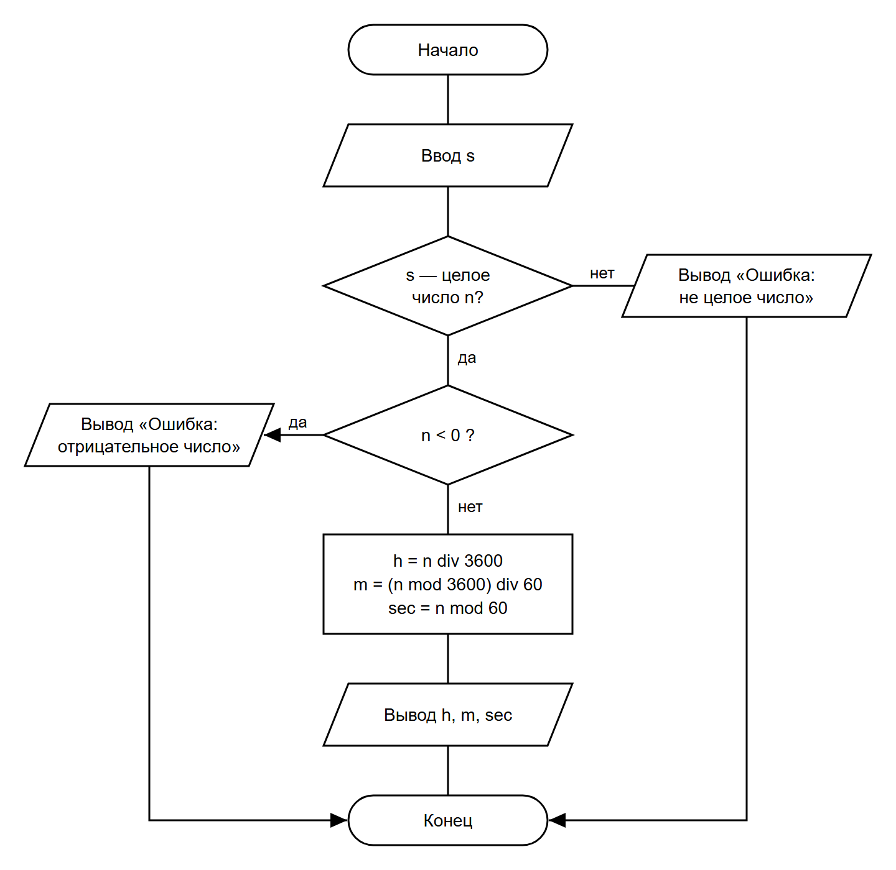

# СРСП 1. Перевод секунд в часы, минуты и секунды

**Задача.** Дано целое число секунд (не меньше 0). Нужно перевести его в часы, минуты и секунды.

## 1. Словесная запись алгоритма

1. Начало.
2. Ввести строку `s`.
3. Проверить, является ли `s` целым числом. Если нет — вывести «Ошибка: введено не целое число» и перейти к шагу 9.
4. Преобразовать `s` в целое число `n`.
5. Проверить, меньше ли `n` нуля. Если да — вывести «Ошибка: число не может быть отрицательным» и перейти к шагу 9.
6. Вычислить часы: `h = n div 3600`.
7. Вычислить минуты: `m = (n mod 3600) div 60` и секунды: `sec = n mod 60`.
8. Вывести `h`, `m`, `sec`.
9. Конец.

## 2. Псевдокод

```
алг ПереводСекунд
нач
    ввод s
    если s не является целым числом то
        вывод "Ошибка: введено не целое число"
    иначе
        n := целое(s)
        если n < 0 то
            вывод "Ошибка: число не может быть отрицательным"
        иначе
            h   := n div 3600
            m   := (n mod 3600) div 60
            sec := n mod 60
            вывод h, " ч ", m, " мин ", sec, " сек"
        все
    все
кон
```

## 3. Схема алгоритма (ГОСТ 19.701-90)

Исходник: [scheme.drawio](scheme.drawio)



## 4. Программа на C#

Код: [Program.cs](Program.cs). Запуск:

```
dotnet run
```

## 5. Проверка

| Ввод    | Ожидаемый результат | Фактический вывод программы |
|---------|---------------------|-----------------------------|
| 3725    | 1 ч 2 мин 5 сек     | `1 ч 2 мин 5 сек`           |
| 59      | 0 ч 0 мин 59 сек    | `0 ч 0 мин 59 сек`          |
| 86399   | 23 ч 59 мин 59 сек  | `23 ч 59 мин 59 сек`        |
| 0       | 0 ч 0 мин 0 сек     | `0 ч 0 мин 0 сек`           |

Некорректный ввод (программа не падает):

| Ввод    | Вывод программы                               |
|---------|-----------------------------------------------|
| abc     | `Ошибка: введено не целое число.`             |
| 12.5    | `Ошибка: введено не целое число.`             |
| -5      | `Ошибка: число не может быть отрицательным.`  |
| (пусто) | `Ошибка: введено не целое число.`             |
