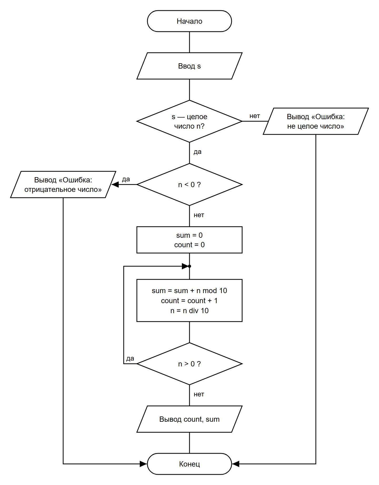

# СРСП 2. Количество и сумма цифр числа

**Задача.** Дано целое число `n` (не меньше 0). Найти, сколько в нём цифр и чему равна их сумма.

**Идея.** Последняя цифра числа — это `n mod 10`. Прибавляем её к сумме, увеличиваем счётчик и «отрезаем» её: `n = n div 10`. Повторяем, пока число не станет 0.

**Какой цикл нужен.** У числа 0 одна цифра — 0. Если взять цикл с предусловием (`пока n > 0`), то при `n = 0` тело не выполнится ни разу, и программа ответит «0 цифр» — это неверно. Поэтому нужен **цикл с постусловием** (`do ... while`): тело выполняется хотя бы один раз, и для 0 получаем 1 цифру с суммой 0.

## 1. Псевдокод

```
алг КоличествоИСуммаЦифр
нач
    ввод s
    если s не является целым числом то
        вывод "Ошибка: введено не целое число"
    иначе
        n := целое(s)
        если n < 0 то
            вывод "Ошибка: число не может быть отрицательным"
        иначе
            sum := 0
            count := 0
            повторять
                sum := sum + n mod 10
                count := count + 1
                n := n div 10
            до тех пор, пока n > 0
            вывод "Количество цифр: ", count
            вывод "Сумма цифр: ", sum
        все
    все
кон
```

## 2. Схема алгоритма (ГОСТ 19.701-90)

Исходник: [scheme.drawio](scheme.drawio)



## 3. Таблица ручной трассировки

Значения записаны **после** выполнения тела цикла на каждой итерации.

### n = 472

| Итерация | n   | Сумма | Количество | Условие цикла `n > 0` |
|----------|-----|-------|------------|-----------------------|
| 0 (до цикла) | 472 | 0  | 0 | —                     |
| 1        | 47  | 2     | 1          | 47 > 0 — да, повтор   |
| 2        | 4   | 9     | 2          | 4 > 0 — да, повтор    |
| 3        | 0   | 13    | 3          | 0 > 0 — нет, выход    |

Результат: количество цифр **3**, сумма **13** (4 + 7 + 2 = 13).

### n = 0

| Итерация | n | Сумма | Количество | Условие цикла `n > 0` |
|----------|---|-------|------------|-----------------------|
| 0 (до цикла) | 0 | 0 | 0 | —                    |
| 1        | 0 | 0     | 1          | 0 > 0 — нет, выход    |

Результат: количество цифр **1**, сумма **0**. Тело цикла выполнилось один раз — именно поэтому выбран цикл с постусловием.

## 4. Программа на C#

Код: [Program.cs](Program.cs). Запуск:

```
dotnet run
```

## 5. Проверка

| Ввод | Ожидается            | Вывод программы                          |
|------|----------------------|------------------------------------------|
| 472  | 3 цифры, сумма 13    | `Количество цифр: 3`<br>`Сумма цифр: 13` |
| 0    | 1 цифра, сумма 0     | `Количество цифр: 1`<br>`Сумма цифр: 0`  |
| 7    | 1 цифра, сумма 7     | `Количество цифр: 1`<br>`Сумма цифр: 7`  |
| 1000 | 4 цифры, сумма 1     | `Количество цифр: 4`<br>`Сумма цифр: 1`  |

Некорректный ввод (программа не падает):

| Ввод    | Вывод программы                              |
|---------|----------------------------------------------|
| abc     | `Ошибка: введено не целое число.`            |
| 4.5     | `Ошибка: введено не целое число.`            |
| -5      | `Ошибка: число не может быть отрицательным.` |
| (пусто) | `Ошибка: введено не целое число.`            |
