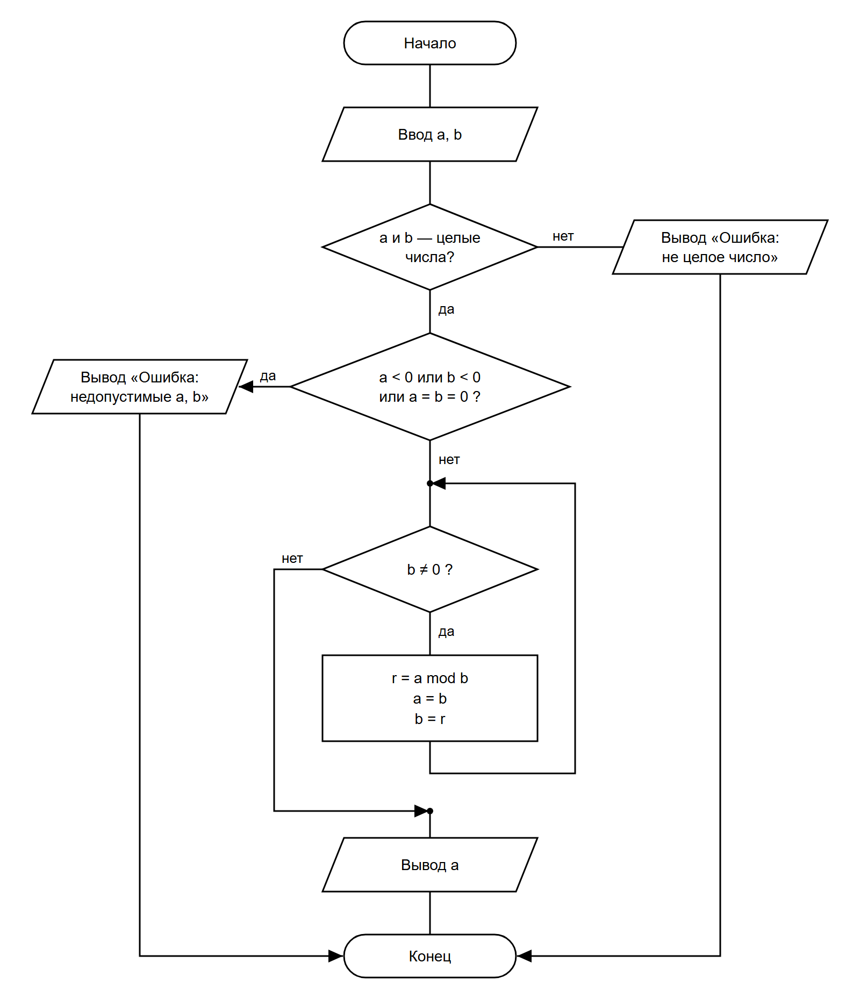

# СРСП 3. НОД двух чисел: алгоритм Евклида с остатком

**Алгоритм (задан преподавателем):**

```
ввод a, b   (a ≥ 0, b ≥ 0, не оба равны нулю)
нц пока b ≠ 0
    r := a mod b
    a := b
    b := r
кц
вывод a
```

Программа: [../Gcd/Program.cs](../Gcd/Program.cs)

## 1. Схема алгоритма (ГОСТ 19.701-90)

Исходник: [scheme.drawio](scheme.drawio)



На схеме три решения:
- **Р1** «a и b — целые числа?» — проверка формата ввода;
- **Р2** «a < 0 или b < 0 или a = b = 0?» — проверка допустимых значений;
- **Р3** «b ≠ 0?» — условие цикла с предусловием.

## 2. Таблица тестов

Ожидаемый результат записан до запуска программы (по алгоритму, вручную).
Столбец «Покрывает» — какой выход какого решения проверяет тест.

| № | a   | b   | Покрывает                                   | Ожидаемый результат | Фактический результат | Итог |
|---|-----|-----|---------------------------------------------|---------------------|-----------------------|------|
| 1 | 48  | 18  | Р1 — да, Р2 — нет, Р3 — да (3 итерации), Р3 — нет | НОД = 6       | `НОД = 6`             | ✅ |
| 2 | 18  | 48  | Р3 — да: первая итерация меняет a и b местами | НОД = 6           | `НОД = 6`             | ✅ |
| 3 | 7   | 0   | **Ноль итераций:** Р3 — нет сразу           | НОД = 7             | `НОД = 7`             | ✅ |
| 4 | 0   | 5   | Р3 — да (1 итерация), a = 0 допустимо       | НОД = 5             | `НОД = 5`             | ✅ |
| 5 | 17  | 5   | Взаимно простые числа                       | НОД = 1             | `НОД = 1`             | ✅ |
| 6 | 12  | 12  | Равные числа                                | НОД = 12            | `НОД = 12`            | ✅ |
| 7 | abc | 5   | **Некорректный ввод:** Р1 — нет (a не число) | Ошибка: не целое число | `Ошибка: введено не целое число.` | ✅ |
| 8 | 5   | 2.5 | Р1 — нет (b дробное)                        | Ошибка: не целое число | `Ошибка: введено не целое число.` | ✅ |
| 9 | (пусто) | (пусто) | Р1 — нет (пустой ввод)              | Ошибка: не целое число | `Ошибка: введено не целое число.` | ✅ |
| 10 | -4 | 6   | Р2 — да (a < 0)                             | Ошибка: недопустимые a, b | `Ошибка: нужно a ≥ 0, b ≥ 0, и они не могут быть оба равны 0.` | ✅ |
| 11 | 4  | -6  | Р2 — да (b < 0)                             | Ошибка: недопустимые a, b | `Ошибка: нужно a ≥ 0, b ≥ 0, и они не могут быть оба равны 0.` | ✅ |
| 12 | 0  | 0   | Р2 — да (оба равны 0)                       | Ошибка: недопустимые a, b | `Ошибка: нужно a ≥ 0, b ≥ 0, и они не могут быть оба равны 0.` | ✅ |

Все выходы всех решений покрыты: Р1 — да/нет, Р2 — да/нет, Р3 — да/нет, а также случай нуля итераций (тест 3).

## 3. Трассировка при a = 48, b = 18

| Итерация | Условие `b ≠ 0` | r = a mod b   | a  | b  |
|----------|-----------------|---------------|----|----|
| 0 (до цикла) | —           | —             | 48 | 18 |
| 1        | 18 ≠ 0 — да     | 48 mod 18 = 12 | 18 | 12 |
| 2        | 12 ≠ 0 — да     | 18 mod 12 = 6  | 12 | 6  |
| 3        | 6 ≠ 0 — да      | 12 mod 6 = 0   | 6  | 0  |
| —        | 0 ≠ 0 — нет, выход | —           | 6  | 0  |

**Результат:** вывод `a = 6`, то есть НОД(48, 18) = 6.

## 4. Запуск проекта

```
cd ../Gcd
dotnet run
```

Пример работы:

```
Введите a: 48
Введите b: 18
НОД = 6
```
