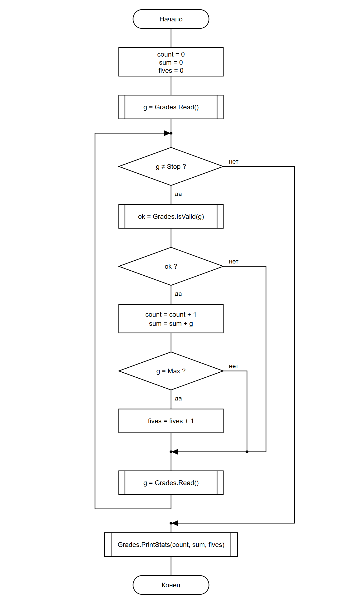

# СРСП 4. Декомпозиция программы «Статистика оценок»

Программа «Статистика оценок» (схема Б из практической работы 3) разбита на методы.

**Что делает программа.** Оценки вводятся по одной, каждая с новой строки, ввод заканчивается числом `0`. Неверная оценка (не число или вне диапазона 2–5) пропускается. В конце выводятся количество оценок, средний балл и число пятёрок. Если верных оценок не было, выводится «Оценок нет».

Проект: [GradesStats/Program.cs](GradesStats/Program.cs)

## 1. Структура программы

Сначала идут инструкции верхнего уровня (главный алгоритм), после них `static class Grades` с методами:

| Метод | Назначение |
|-------|------------|
| `int Read()` | читает оценку; нечисловой ввод возвращает `-1` |
| `bool IsValid(int g)` | `true`, если оценка от `Min` до `Max` (от 2 до 5) |
| `void PrintStats(int count, int sum, int fives)` | выводит итог или «Оценок нет» |

## 2. Константы

Вместо чисел в коде используются именованные константы класса `Grades`:

```csharp
public const int Min = 2;   // минимальная оценка
public const int Max = 5;   // максимальная оценка (пятёрка)
public const int Stop = 0;  // признак конца ввода
```

## 3. Схема верхнего уровня (ГОСТ 19.701-90)

Исходник: [scheme.drawio](scheme.drawio)



Вызовы методов `Grades.Read()`, `Grades.IsValid(g)` и `Grades.PrintStats(...)` обозначены символом **«предопределённый процесс»** (прямоугольник с двойными боковыми линиями). Подробности работы каждого метода на схеме верхнего уровня не показываются: они описаны в самих методах.

## 4. Проверка

Каждое значение вводится с новой строки.

| № | Ввод | Что проверяет | Ожидаемый результат | Вывод программы |
|---|------|---------------|---------------------|-----------------|
| 1 | 5, 4, 5, 0 | несколько итераций, ветки `g = Max` — да и нет | 3 оценки, средний 4,67, пятёрок 2 | `Количество оценок: 3`<br>`Средний балл: 4,67`<br>`Пятёрок: 2` |
| 2 | 0 | ноль итераций, случай «оценок нет» | Оценок нет | `Оценок нет` |
| 3 | 3, 7, abc, 2, 0 | пропуск неверной оценки: `7` — вне диапазона, `abc` — не число (`Read` вернул −1) | 2 оценки, средний 2,50, пятёрок 0 | `Количество оценок: 2`<br>`Средний балл: 2,50`<br>`Пятёрок: 0` |

Перед каждым вводом программа выводит приглашение `Оценка (0 — конец): `; в таблице оно не показано.

Если ввод закончился без `0` (конец файла), `Read()` возвращает `Stop`, чтобы программа не зациклилась.

## Запуск

```
cd GradesStats
dotnet run
```
